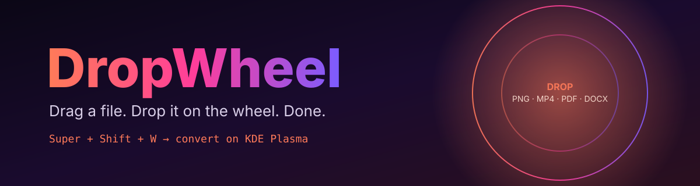

<div align="center">



### ⚡ Drag · Hold · Drop · Converted

A radial, drag-to-convert file wheel for **KDE Plasma**.
No menus. No upload. Just a wheel that appears under your cursor.

[](LICENSE)
[](#-requirements)
[](#-install)
[](#-requirements)
[](#-status)

</div>

---

## ✦ What it does

Grab a file in Dolphin, press **Super + Shift + W**, and a glass wheel blooms under your cursor.
The segments change to match what you're holding. Drop the file on a slice and it converts.

```
                 ╭──────────── MP4 ────────────╮
          COMPRESS                          WEBM
        ╱                                        ╲
     AUDIO                 ◉ VIDEO                 GIF
        ╲                                        ╱
          MKV                               MP3 AUDIO
                 ╰────────────────────────────╯
              drop your .mp4 on any slice  ↓
```

## ◈ Features

| | Feature | Details |
|---|---|---|
| 🖼️ | **Image** | PNG · JPG · WEBP · AVIF · PDF · ICO · compress · strip metadata |
| 🎞️ | **Video** | MP4 · WebM · GIF · MKV · extract MP3 · compress |
| 🎧 | **Audio** | MP3 · FLAC · WAV · OGG · Opus · M4A |
| 📄 | **PDF** | Export pages as PNG/JPG · extract text · compress |
| 📝 | **Documents** | PDF · DOCX · ODT · TXT · HTML · Markdown |
| 🧲 | **Multi-drop** | Drag several same-type files at once |
| 🔔 | **Notifications** | Native KDE alerts when a job finishes or fails |
| 🗂️ | **Dolphin menu** | Right-click → *Convert with DropWheel* |
| 🛡️ | **Safe by default** | Results land next to originals. Nothing is overwritten or moved. |

## ◈ Requirements

- **KDE Plasma 6** (built and aimed at Fedora 44)
- **Python 3.10+** with PySide6
- **ImageMagick · FFmpeg (full build) · Poppler · Ghostscript · Pandoc · LibreOffice · libnotify**

## ◈ Install

```bash
git clone https://github.com/saravanan2006-coder/dropwheel.git
cd dropwheel
bash install.sh
```

The installer pulls the dependencies with `dnf`, registers the Dolphin action,
and starts the background listener at login.

> 🎬 **Full video codecs** come from RPM Fusion. The installer has the two commands
> as comments at the top.

## ◈ Shortcut

| Action | Default |
|---|---|
| Open the wheel | `Super + Shift + W` |
| Cancel | `Esc` or click outside |

Change it in **System Settings → Keyboard → Shortcuts → DropWheel**.

## ◈ Command line

```bash
dropwheel --show          # open the wheel
dropwheel --daemon        # start the background listener
dropwheel photo.png ...   # open the wheel with files already loaded
```

## ◈ Status

> **Early release.** The conversion pipeline and wheel UI work. The global hotkey
> during a drag is still being tested across Plasma and Wayland setups.
> If something breaks on your machine, please open an issue.

## ◈ Roadmap

- [ ] Crop, annotate, and background editors
- [ ] Batch presets (e.g. "web-ready image")
- [ ] Flatpak and COPR packages
- [ ] Custom wheel layouts through a config file

## ◈ Contributing

Pull requests are welcome. Keep each one focused on a single change, and describe
how you tested it.

## ◈ License

Released under the [MIT License](LICENSE). Use it, fork it, ship it.

---

<div align="center">

Built with ⚡ by **Saravanan P** · Villupuram, Tamil Nadu

</div>
